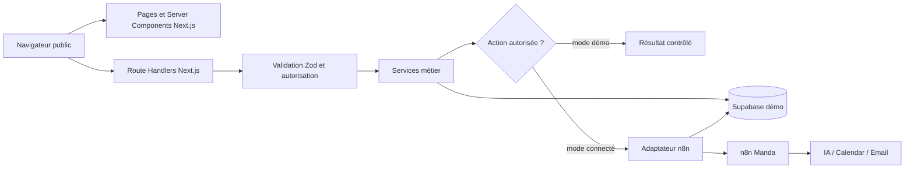
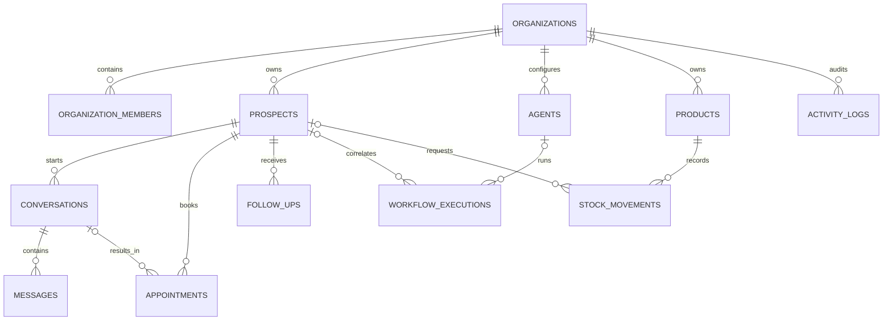
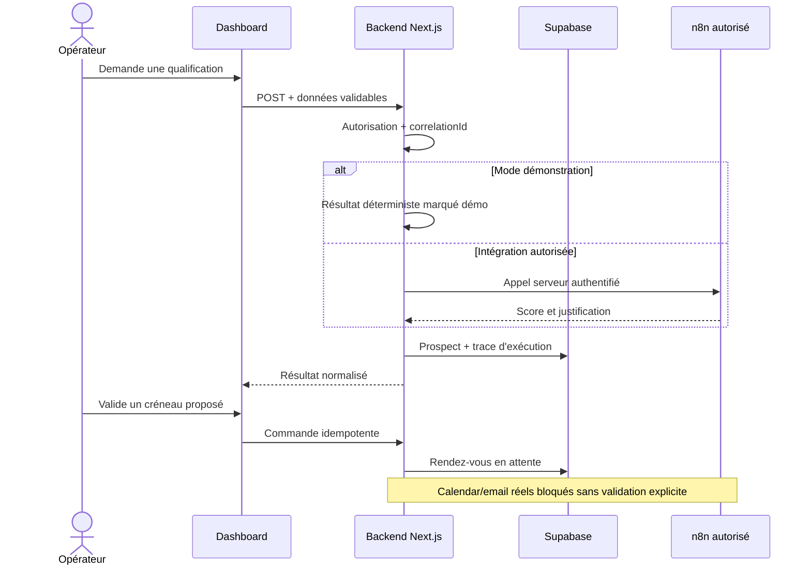
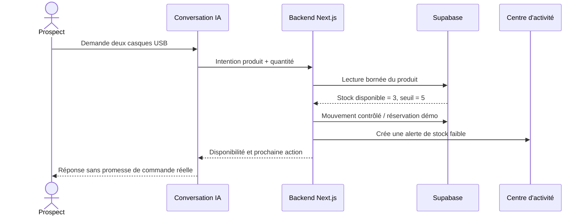

# Architecture technique — Orchestra

## 1. Contexte et objectif

Orchestra est un prototype SaaS destiné à démontrer la conception d'un produit
pour une agence d'automatisation IA. Il centralise un CRM léger, les conversations,
les rendez-vous, les relances, les agents n8n et un scénario de stock.

Le prototype privilégie les fonctionnalités démontrables et distingue toujours :

- les données locales de démonstration ;
- les intégrations configurées mais non exécutées ;
- les intégrations réellement vérifiées ;
- les effets externes bloqués en attente d'une validation humaine.

## 2. Stack et justification

- **Next.js 16.4 avec App Router et TypeScript strict** : interface et backend
  dans un même projet, Server Components par défaut et Route Handlers pour les
  frontières HTTP.
- **Tailwind CSS 4 et composants source compatibles shadcn/ui** : système UI
  léger, auditable et personnalisable.
- **Tabler Icons** : iconographie linéaire cohérente avec la référence Meckia.
- **Recharts** : graphiques accessibles et responsives.
- **Supabase / PostgreSQL 17** : persistance dédiée, contraintes relationnelles,
  RLS et migrations versionnées.
- **n8n Manda** : orchestration des fonctions IA existantes, jamais exposée
  directement au navigateur.
- **Zod** : validation des variables, requêtes et réponses externes.
- **Vercel** : cible de déploiement du dashboard, après validation du propriétaire.

## 3. Architecture frontend/backend

Le navigateur n'obtient jamais l'URL privée n8n, sa clé API ou une clé Supabase
secrète. Les pages utilisent des Server Components sauf pour l'interactivité
locale : menu mobile, filtres CRM et graphiques.

## 4. Rôle de Supabase

La migration locale crée :

- `orchestra_organizations` et `orchestra_organization_members` ;
- `orchestra_prospects` ;
- `orchestra_conversations` et `orchestra_messages` ;
- `orchestra_appointments` ;
- `orchestra_follow_ups` ;
- `orchestra_agents` et `orchestra_workflow_executions` ;
- `orchestra_products` et `orchestra_stock_movements` ;
- `orchestra_activity_logs`.

Toutes les relations métier incluent `organization_id`. Les clés étrangères
composites empêchent de relier des enregistrements appartenant à deux organisations
différentes. Les listes croissantes sont indexées pour une pagination par curseur
sur `(created_at, id)`.

RLS est activé et forcé sur toutes les tables. La version actuelle n'accorde
aucune politique aux clients `anon` ou `authenticated` : la base sera appelée par
le backend avec la clé serveur. Une future interface authentifiée devra introduire
des politiques d'organisation testées avant tout accès direct.

## 5. Rôle de n8n et des agents IA

L'audit a identifié trois modules réutilisables sans effet externe direct :

- recherche et qualification de prospects français ;
- scoring de leads LinkedIn, avec coût fournisseur potentiel ;
- génération de messages personnalisés, sans envoi.

Le Chat Agent Showcase est également pertinent, mais il possède des outils Gmail
et Google Calendar. Il restera bloqué dans le prototype public jusqu'à la création
d'un chemin isolé ou d'une autorisation humaine explicite.

Les workflows originaux ne sont ni modifiés ni éditables depuis Orchestra.

## 6. Communications entre composants

Une commande applicative suit ce contrat :

1. le navigateur appelle une route Next.js publique ou authentifiée ;
2. la route limite la taille et valide le corps ;
3. elle produit ou propage un `correlationId` ;
4. le service vérifie le mode démo, la liste blanche et l'autorisation ;
5. l'adaptateur appelle n8n avec un délai maximal ;
6. la réponse n8n est validée avant transformation ;
7. l'état et une synthèse non sensible sont enregistrés ;
8. une erreur stable est retournée au client sans détail interne.

La route de qualification actuellement présente fonctionne localement en mode
démo. En mode connecté, elle exige un jeton d'action serveur et une configuration
explicite avant d'appeler le workflow autorisé.

## 7. Modèle de données

Les mouvements de stock ne modifient pas implicitement la quantité via un
déclencheur caché. Le futur service stock réalisera l'écriture du mouvement et la
mise à jour du produit dans une transaction courte et testée.

## 8. Variables d'environnement

`.env.example` documente les variables nécessaires. Les nouvelles clés Supabase
`publishable` et `secret` sont utilisées à la place des anciennes clés
`anon/service_role`, encore compatibles mais en fin de transition.

- les variables `NEXT_PUBLIC_*` peuvent atteindre le navigateur ;
- `SUPABASE_SECRET_KEY`, `N8N_API_KEY`, `N8N_WEBHOOK_SECRET` et
  `APP_ACTION_TOKEN` sont exclusivement serveur ;
- `DEMO_MODE=true` et `ALLOW_EXTERNAL_SIDE_EFFECTS=false` sont les valeurs sûres
  par défaut.

## 9. Sécurité des API et webhooks

- validation Zod à toutes les frontières ;
- limite explicite de taille des requêtes ;
- comparaison en temps constant du jeton d'action ;
- délai maximal des appels n8n ;
- validation de l'origine de l'URL n8n ;
- clés d'idempotence prévues dans `workflow_executions` ;
- RLS et absence de droits client par défaut ;
- validation humaine obligatoire avant relance, email ou calendrier réel ;
- aucune donnée client réelle dans le jeu de démonstration.

Avant une ouverture publique d'actions payantes, il faudra ajouter une identité
utilisateur, un throttling durable partagé et des quotas par organisation.

## 10. Logs, erreurs et traçabilité

Les erreurs API utilisent des codes stables et un `correlationId`. Les logs serveur
ne doivent contenir ni clé, ni corps complet, ni donnée personnelle brute. La table
`workflow_executions` conserve les statuts et synthèses ; `activity_logs` conserve
les actions métier affichables.

## 11. Flux métier — qualification et rendez-vous

## 12. Flux métier — conversation et stock

## 13. Déploiement

1. lint, typecheck, tests et build vérifiés ;
2. migration isolée appliquée au projet Supabase `n8n` après autorisation ;
3. variables Supabase configurées dans Vercel, secret serveur marqué sensible ;
4. déploiement public réalisé en mode démonstration ;
5. pages, API de santé et interactions desktop/mobile vérifiées en production.

## 14. Limites actuelles

- données du dashboard encore locales et simulées ;
- migration appliquée au projet Supabase partagé `n8n`, avec tables préfixées
  `orchestra_` et sans modification des objets n8n existants ;
- aucun appel n8n exécuté depuis l'application ;
- aucune authentification opérateur ;
- aucune synchronisation Calendar ou Gmail réelle ;
- aucun envoi de relance ;
- les données métier affichées restent simulées malgré le déploiement Vercel et
  la connexion Supabase vérifiés.

## 15. Passage en production

Une version de production nécessiterait notamment : authentification et MFA,
politiques RLS par organisation, throttling partagé, file durable pour les tâches
longues, callbacks signés, rotation de secrets, Sentry ou OpenTelemetry, métriques
de coût n8n/IA, sauvegardes testées, procédures de reprise, rétention RGPD et tests
E2E des parcours critiques.
