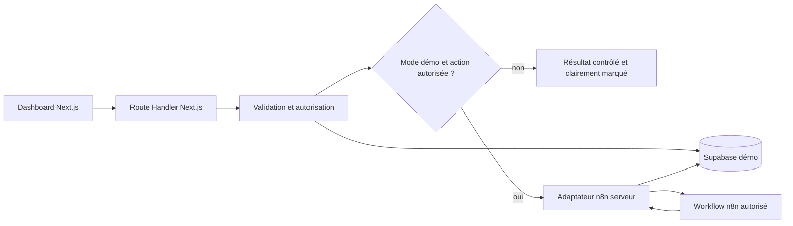

# Audit n8n — prototype d'agence d'automatisation IA

Date de l'audit : 10 novembre 2026  
Instance auditée : instance personnelle Manda (`n8n Manda`)  
Mode d'audit : lecture seule via MCP, sans exécution ni modification de workflow

## Résumé exécutif

L'instance expose 34 workflows. Les meilleurs candidats pour le prototype sont le
chat conversationnel du showcase, la recherche de prospects français, la
qualification de leads LinkedIn et la génération de messages personnalisés.

Ces workflows ne doivent jamais être appelés directement depuis le navigateur.
L'application utilisera une couche serveur Next.js qui valide les entrées, ajoute
l'authentification n8n, applique les quotas et journalise un identifiant de
corrélation. Le mode démonstration restera sans effet externe par défaut.

Les identifiants complets, URLs privées et noms de credentials ont été vérifiés
pendant l'audit mais ne sont volontairement pas recopiés dans ce document destiné
à un futur dépôt public. Les références abrégées permettent de retrouver les
workflows côté instance sans exposer leur configuration.

## Workflows réutilisables

| Workflow | Référence auditée | État observé | Déclencheur | Entrées principales | Sorties principales | Décision |
| --- | --- | --- | --- | --- | --- | --- |
| Chat Agent Showcase | `aAzD…whr` | actif | webhook `POST`, authentifié par en-tête | `scenario`, `sessionId`, `userMessage` | `reply`, `sessionId`, `scenario`, `generatedAt` | Réutilisable derrière un adaptateur serveur, uniquement avec effets externes désactivés ou explicitement autorisés |
| Recherche Prospects FR | `nHSB…4u0` | actif | webhook `POST`, authentifié par en-tête | mode de recherche, critères société/secteur/personne, `maxResults` borné | liste de leads, score, tier, raisonnement, hooks | Réutilisable pour une qualification contrôlée ; persistance locale après validation du résultat |
| LinkedIn Leads | `1zPg…1dA` | actif | webhook `POST`, authentifié par en-tête | critères de recherche LinkedIn | jusqu'à 5 leads, score, tier, raisonnement ou erreur de quota | Démonstration optionnelle seulement : coût fournisseur et latence annoncée de 30–50 s |
| Message Personnalisé | `rZLc…eKt` | actif | webhook `POST`, authentifié par en-tête | `lead`, `tone?`, `contexte?` | variantes email, InMail et connexion | Réutilisable pour proposer une relance ; jamais d'envoi automatique |
| Contact Form + Auto-Reply | `MJmX…B40` | actif | webhook `POST` sans authentification n8n | données de contact et locale | notification, auto-réponse et écritures Google Sheets | Ne pas réutiliser pour la démo publique : effets externes immédiats et contrat trop couplé au portfolio |
| Garage Antananarivo — Rendez-vous | `Q4cJ…Qwi` | actif | webhook `POST` | service, nom, téléphone, date, heure et véhicule | événement Calendar, email et réponse JSON | Ne pas appeler depuis le prototype : création réelle d'événement et secret historique intégré à la logique du workflow |
| Follow-up Intelligent Multi-Étapes | `Gt73…EDN` | inactif | non accessible via MCP | non vérifiable | non vérifiable | Non réutilisable tant que le propriétaire ne l'expose pas à l'audit et ne confirme pas son contrat |
| Voice Agent — Appointment Orchestrator | `BcMF…0ut` | actif mais non accessible via MCP | trois déclencheurs signalés | non vérifiable | non vérifiable | Ne pas intégrer sans audit complet et environnement de test isolé |

## Analyse du Chat Agent Showcase

Le workflow prend en charge trois scénarios : suivi de colis fictif, rendez-vous
chez un dentiste et rendez-vous dans un garage. Il contient :

- une mémoire de session ;
- un agent conversationnel ;
- une limite quotidienne globale et par IP ;
- un outil de suivi de colis fictif ;
- une consultation Google Calendar ;
- une création d'événement Google Calendar ;
- un envoi d'email Gmail ;
- une réponse JSON structurée.

Le contrat d'entrée observé est :

```json
{
  "scenario": "colis | dentiste | garagiste",
  "sessionId": "identifiant stable de conversation",
  "userMessage": "message de l'utilisateur"
}
```

Le contrat de sortie observé est :

```json
{
  "reply": "réponse de l'agent",
  "sessionId": "identifiant de conversation",
  "scenario": "scénario actif",
  "generatedAt": "date ISO-8601"
}
```

### Limites pour le prototype

Le même agent peut consulter puis modifier un calendrier et envoyer un email.
Cette combinaison est adaptée à une démo contrôlée, mais trop risquée pour un
dashboard public librement accessible. L'application ne transmettra donc pas une
demande de confirmation réelle en mode démonstration. Le parcours public simulera
la proposition et la validation du créneau dans la base dédiée. Une activation
réelle nécessitera une action humaine explicite et un workflow isolé.

## Historique d'exécution observé

La recherche d'exécutions n'a retourné aucun historique conservé pour les quatre
modules du showcase ni pour le workflow de rendez-vous garage au moment de
l'audit. Cela ne prouve pas qu'ils n'ont jamais été exécutés : la rétention n8n
peut avoir supprimé les anciennes exécutions.

Le workflow `Contact Form + Auto-Reply` présentait trois exécutions webhook
récentes, toutes réussies, les 9 et 10 novembre 2026. Ce workflow est donc actif
dans un usage réel et doit rester isolé du prototype.

## Fonctionnalités manquantes

L'instance ne fournit pas de workflow audité et réutilisable pour :

- la gestion de stock ;
- la réservation de stock ou la création de mouvements ;
- la persistance du CRM du prototype ;
- la synchronisation fiable des exécutions n8n avec une base dédiée ;
- un callback signé et idempotent destiné au nouveau dashboard ;
- une relance de démonstration sans envoi réel ;
- un parcours de rendez-vous entièrement isolé des calendriers existants.

Ces responsabilités seront d'abord implémentées dans Next.js et Supabase. Aucun
nouveau workflow n'est nécessaire pour construire la première version du
dashboard.

## Architecture d'intégration retenue



Chaque appel serveur utilisera :

- un schéma d'entrée strict ;
- un identifiant de corrélation ;
- un délai maximal ;
- une clé d'idempotence pour les commandes ;
- une liste blanche de workflows et d'actions ;
- des erreurs stables sans fuite d'information interne ;
- des logs sans secrets ni données personnelles brutes ;
- une validation humaine avant email, calendrier ou prospection réelle.

## Variables serveur prévues

Les noms définitifs seront ajustés pendant l'implémentation. Aucune valeur ne sera
commise.

```dotenv
N8N_BASE_URL=
N8N_API_KEY=
N8N_WEBHOOK_SECRET=
N8N_CHAT_WEBHOOK_PATH=
N8N_PROSPECT_SEARCH_WEBHOOK_PATH=
N8N_MESSAGE_WEBHOOK_PATH=
N8N_LINKEDIN_WEBHOOK_PATH=
DEMO_MODE=true
ALLOW_EXTERNAL_SIDE_EFFECTS=false
```

## Garde-fous immédiats

1. Ne modifier aucun workflow existant.
2. Ne lancer aucun workflow pendant le développement sans revue de ses effets.
3. Ne jamais exposer l'URL n8n, une clé ou un identifiant interne au navigateur.
4. Ne jamais appeler le workflow de formulaire portfolio depuis le prototype.
5. Ne jamais appeler le workflow garage existant depuis le prototype.
6. Conserver les relances en brouillon avec validation humaine obligatoire.
7. Afficher « simulé », « configuré » ou « vérifié » selon l'état réel de chaque intégration.

## Conclusion de phase

La phase d'audit confirme qu'une partie importante du showcase peut être réutilisée
sans modifier l'existant. La première version du produit peut être construite avec
des données de démonstration fiables, puis branchée progressivement aux trois
modules sans effet externe : recherche de prospects, scoring et génération de
message. Le chat sera intégré après ajout d'une barrière serveur empêchant toute
création de rendez-vous ou tout email involontaire.
